<!--
  This README is one inference run: a prompt comes in, passes through
  attention and tool calls, emits outputs, reports telemetry, and hands off.
  Edit build/config.py, not the SVGs. The "profile" workflow re-renders daily.
-->

<div align="center">
  
</div>

<br/>


```python
class Shreshth(Engineer):
    role     = "AI Product Engineer"
    location = "India 🇮🇳"
    builds   = ["LLM products", "agentic systems", "voice AI"]
    owns     = "0 → 1 : design → backend → AI → deploy"
    stack    = ["Python", "TypeScript", "FastAPI", "Next.js"]

    def philosophy(self) -> str:
        return "Ship production-grade. Reliable, observable, real."
```


<div align="center">
  
</div>


<div align="center">
  
</div>


<div align="center">
<!-- outputs:start -->
<a href="https://github.com/root4shreshth/HealioX"></a>
<a href="https://github.com/root4shreshth/incident-commander"></a>
<a href="https://github.com/root4shreshth/PaySense-ai"></a>
<a href="https://github.com/root4shreshth?tab=repositories"></a>
<!-- outputs:end -->
</div>


<div align="center">
  
</div>


<div align="center">

```ts
await shreshth.connect({ channel: "whatever works for you" })
```

<a href="https://linkedin.com/in/hype4shreshth"></a>
<a href="https://x.com/Rootshreshth"></a>
<a href="https://instagram.com/hype4shreshth"></a>
<a href="mailto:hype4shreshth@gmail.com"></a>

<br/><br/>



</div>
